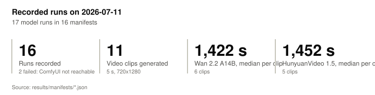
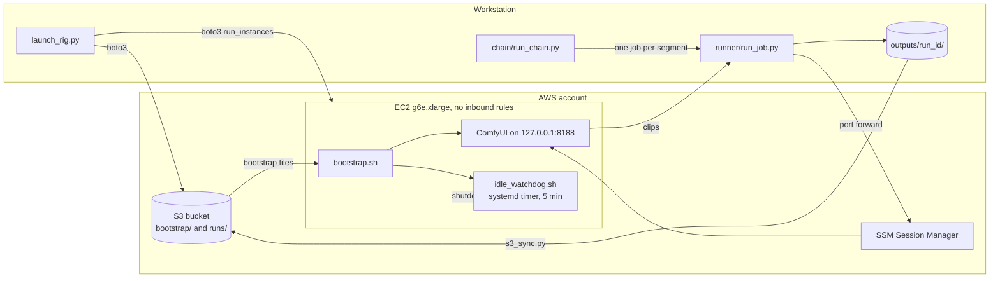
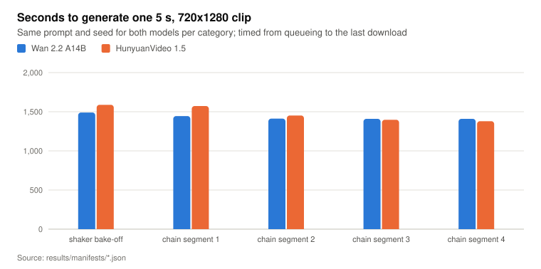
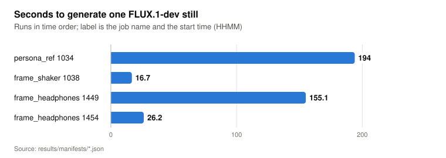

# comfyui-video-rig

Scripts that provision a single-GPU EC2 instance running ComfyUI, submit image and video generation jobs to it over an SSM tunnel, and stop it when it goes idle.

<picture>
  <source media="(prefers-color-scheme: dark)" srcset="docs/figures/summary-dark.svg">
  
</picture>

Figures come from the 16 run manifests in [`results/manifests/`](results/manifests/), recorded on 2026-07-11. [`results/summarize.py`](results/summarize.py) computes every number in [`docs/data.json`](docs/data.json); [`results/README.md`](results/README.md) lists what the manifests measure and how they were edited for publication.

## What it does

- Provisions an S3 bucket, an IAM instance profile and a security group with no inbound rules, then launches a `g6e.xlarge` (1x NVIDIA L40S 48 GB) from the AWS Deep Learning Base AMI ([`launch_rig.py`](launch_rig.py), [`rig.config.toml`](rig.config.toml)).
- Installs ComfyUI, its custom nodes and the FLUX.1-dev, Wan 2.2 A14B and HunyuanVideo 1.5 weights at first boot ([`bootstrap/`](bootstrap/)).
- Runs a job file through one or more models with the same prompt and seed, downloads the outputs, encodes a 9:16 MP4 per model and stacks the first two side by side ([`runner/run_job.py`](runner/run_job.py)).
- Chains 5 s image-to-video segments into longer clips, each segment starting from the last frame of the one before ([`chain/`](chain/)).
- Stops the instance on GPU idle, on a hung job and on a stuck bootstrap ([`bootstrap/idle_watchdog.sh`](bootstrap/idle_watchdog.sh)).
- Prints every AWS call, ComfyUI request and ffmpeg command without executing any of them when given `--dry-run`.

## How it works



1. `launch_rig.py provision` creates the bucket (public access blocked), uploads `bootstrap/`, and creates the role and security group. The role can read `bootstrap/` in the bucket, read the Hugging Face token parameter, and register with SSM.
2. `launch_rig.py launch` resolves the AMI from its SSM alias and starts the instance. User data arms `shutdown -h +180` and runs `bootstrap.sh`, which installs ComfyUI, downloads the model groups listed in `rig.config.toml`, starts ComfyUI as a systemd service bound to 127.0.0.1, enables the watchdog timer and then cancels the 180 minute shutdown.
3. `launch_rig.py tunnel` forwards local port 8188 to ComfyUI through SSM. There is no SSH and no open port.
4. `run_job.py` reads a job TOML, loads the API-format workflow for each model from [`workflows/`](workflows/), writes job values into nodes titled `RIG_*` (prompt, seed, start image, frame count), queues it, polls `/history`, downloads the outputs and writes `manifest.json` with every parameter and the elapsed time.
5. `s3_sync.py` uploads the run folder and prints presigned links valid for 7 days (`PRESIGN_TTL_S` in [`runner/s3_sync.py`](runner/s3_sync.py)).

## Results

The runs below were made on one day of testing. The manifests do not record the instance type or software versions; that they ran on `g6e.xlarge` is inferred from `rig.config.toml`.

<picture>
  <source media="(prefers-color-scheme: dark)" srcset="docs/figures/video-clip-time-dark.svg">
  
</picture>

Source: `results/manifests/*.json`, chart `video-clip-time` in `docs/data.json`.

- Each 5 s, 720x1280 clip took between 1,378.9 s and 1,587.9 s from queueing to the last download.
- HunyuanVideo 1.5 took longer than Wan 2.2 A14B on the bake-off and chain segments 1 and 2, and less on segments 3 and 4.
- The Wan 2.2 median (1,422 s, 6 clips) includes run `20260711-103944-video_shaker` (1,432.2 s), which has no HunyuanVideo counterpart and is not in the chart.

<picture>
  <source media="(prefers-color-scheme: dark)" srcset="docs/figures/still-time-dark.svg">
  
</picture>

Source: `results/manifests/*.json`, chart `still-time` in `docs/data.json`.

- FLUX.1-dev stills took 16.7 s to 194.0 s. The two long runs were the first FLUX run of the day and the first FLUX run after the video bake-off. Inference, not measured: the difference is checkpoint loading.

### Wan 2.2 chained clip

[](docs/media/wan22_chain_20s.mp4)

[`docs/media/wan22_chain_20s.mp4`](docs/media/wan22_chain_20s.mp4): Wan 2.2 A14B, four chained 5 s segments, joined by `chain/postprocess.py` from [`jobs/headphones_test/chain.toml`](jobs/headphones_test/chain.toml). The same chain was also run through HunyuanVideo 1.5 (runs `20260711-163511` to `20260711-174924`); its frames are not published because the HunyuanVideo 1.5 licence restricts outputs to its territory (see Models and licences).

- The start frame was generated by FLUX.1-dev from a text prompt (run `20260711-145433-frame_headphones`, seed 555001). No photograph or third-party image was used as input.
- Segment n starts from the last frame of segment n-1 with seed 555100 + n.
- The published file was re-encoded from the joined Wan 2.2 output without audio and without container metadata (libx264, CRF 27, 720x1280, 1.9 MB). The original voiceover track is not included.
- The clip and poster are AI-generated: FLUX.1-dev made the start frame and Wan 2.2 A14B made the motion.

## Quickstart

Requires Python 3.11 or later and [uv](https://docs.astral.sh/uv/). The dry runs need no AWS credentials and make no network calls.

```bash
git clone https://github.com/Nysara-Global-LLC/comfyui-video-rig && cd comfyui-video-rig
uv sync --group dev
uv run pytest -q
uv run python launch_rig.py --dry-run launch
uv run python runner/run_job.py jobs/examples/shaker_demo.toml --dry-run
```

To run it for real you need an AWS account with Session Manager access, the [Session Manager plugin](https://docs.aws.amazon.com/systems-manager/latest/userguide/session-manager-working-with-install-plugin.html) for the AWS CLI, a vCPU quota of at least 4 for "Running On-Demand G and VT instances" (quota code `L-DB2E81BA`; `launch` checks it and warns), and ffmpeg on `PATH`.

```bash
cp .env.example .env                 # set RIG_OUTPUTS_BUCKET to a bucket name you own
set -a; . ./.env; set +a
uv run python launch_rig.py launch   # provisions on first use, then boots the instance
uv run python launch_rig.py session  # optional: sudo tail -f /var/log/rig-bootstrap.log
uv run python launch_rig.py tunnel   # leave open; ComfyUI is at http://localhost:8188
uv run python runner/run_job.py jobs/examples/persona_ref.toml --no-sync
uv run python launch_rig.py stop     # or let the watchdog stop it
```

First boot downloads the model weights before ComfyUI starts. The starter workflows in `workflows/` are hand-written, except `hunyuan15_i2v.json`, which is adapted from the official template; compare them with the ComfyUI built-in templates before the first run ([`workflows/README.md`](workflows/README.md)).

Other commands: `status`, `start`, `terminate` (deletes the instance and its volume), `deprovision` (deletes the security group, role, instance profile and token parameter; keeps the bucket).

### Start frame

`jobs/examples/start_frame.toml` repaints a rough composite with FLUX.1-dev while a mask protects one region. Put the composite and mask in `products/pasteups/`; [`products/README.md`](products/README.md) has the ffmpeg commands that make both. Black in the mask is kept and white is repainted: after decoding, the workflow composites the original pixels back through the mask, so black regions are the input pixels rather than a VAE round trip. The mask must have the same dimensions as the composite. This path has no recorded run; see Limitations.

### Chained clips

A chain starts from a still that is not in the repository. Generate one, pick it, and copy it to the spec's `start_frame` path first:

```bash
uv run python runner/run_job.py jobs/headphones_test/frame_headphones.toml   # prints the run folder, outputs/<run_id>
mkdir -p outputs/headphones_test
cp outputs/<run_id>/flux_persona_ref/<chosen>.png outputs/headphones_test/frame0.png
uv run python chain/run_chain.py jobs/headphones_test/chain.toml   # all models, all segments
uv run python chain/postprocess.py jobs/headphones_test/chain.toml # joins and side-by-side
```

`run_chain.py --model wan22 --start-seg 3` resumes one model from segment 3; it drops that model's records for segment 3 and later from `outputs/headphones_test/chain_state.json` first. `postprocess.py` exits unless every model in the state has all segments and each segment was generated after, and from the last frame of, the one before it.

`chain.toml` holds the persona, the per-segment action beats, the seed base and the model list. Generated segment jobs go to `jobs/headphones_test/generated/`.

A segment is not exactly 5 s: Wan 2.2 renders 81 frames at 16 fps (5.0625 s) and HunyuanVideo 1.5 renders 121 frames at 24 fps (5.0417 s). Joins are stream copies, so output names carry the nominal length (`_20s`) and `postprocess.py` decodes the first-half clip to measure its length before offsetting the voiceover on the second half.

## Cost and safety

| Layer | Setting | Source |
|---|---|---|
| Fail-safe at boot | `shutdown -h +180` in user data, cancelled once the watchdog is live | `launch_rig.py`, `bootstrap/bootstrap.sh` |
| Stuck bootstrap | stop if bootstrap has not finished after 3 h | `bootstrap/idle_watchdog.sh` |
| GPU idle | stop after `idle_stop_minutes = 30` with GPU use under 5 % and an empty ComfyUI queue | `rig.config.toml` |
| Hung job | stop after the ComfyUI queue is busy for `max_job_minutes = 360` | `rig.config.toml` |
| Network | security group with no inbound rules; ComfyUI bound to 127.0.0.1; access through SSM only | `launch_rig.py` |
| Secrets | `HF_TOKEN` stored as an SSM SecureString and read on the instance; the dry run redacts it | `launch_rig.py`, `dry_run.py` |

The watchdog runs every 5 minutes from a systemd timer, with a 600 s grace period after each boot. The instance is launched with `InstanceInitiatedShutdownBehavior=stop`, so a watchdog shutdown stops it. A stopped instance is not billed for compute; its 300 GB gp3 root volume (`root_volume_gb` in `rig.config.toml`) is billed until `terminate`. Check the current on-demand rate for `g6e.xlarge` in your region before launching; this repo records no prices.

## Models and licences

This repository does not distribute model weights. `bootstrap/download_models.py` fetches them on the instance from the Hugging Face repositories in [`bootstrap/models.json`](bootstrap/models.json). Each model has its own licence, which you must read and accept before use.

The licence names and output terms below were read from the upstream licence texts on 2026-10-30. They are a summary, not legal advice; the licence text governs.

| Model | Downloaded from | Licence | Terms for generated outputs |
|---|---|---|---|
| FLUX.1-dev, fp8 checkpoint | `Comfy-Org/flux1-dev` | FLUX.1 [dev] Non-Commercial License v1.1.1 ([text](https://github.com/black-forest-labs/flux/blob/main/model_licenses/LICENSE-FLUX1-dev)) | Section 2(d): Black Forest Labs claims no ownership of outputs, which may be used for any purpose except as the licence prohibits, including training a competing model. Section 2(e): distributing outputs requires content filtering or review, and disclosure of AI generation where the law requires it. |
| Wan 2.2 A14B image-to-video, fp8 | `Comfy-Org/Wan_2.2_ComfyUI_Repackaged` | Apache-2.0 ([model card](https://huggingface.co/Wan-AI/Wan2.2-I2V-A14B), [text](https://github.com/Wan-Video/Wan2.2/blob/main/LICENSE.txt)) | Model card, "License Agreement": the authors claim no rights over generated content; use must not share content that violates law or harms people. |
| HunyuanVideo 1.5 720p image-to-video | `Comfy-Org/HunyuanVideo_1.5_repackaged` | Tencent Hunyuan Community License ([text](https://huggingface.co/tencent/HunyuanVideo-1.5/blob/main/LICENSE)) | Section 1(l) defines the Territory as worldwide excluding the European Union, the United Kingdom and South Korea. Section 5(c) prohibits using, distributing or displaying outputs outside the Territory. For that reason no HunyuanVideo 1.5 output is published in this repository. |

The text encoders, VAEs and vision encoders in the same repositories may carry separate terms; they were not checked. ComfyUI and its custom nodes are installed from their own repositories under their own licences.

## Project layout

```
launch_rig.py          provision, launch, status, stop, start, terminate, tunnel, session, deprovision
rig_config.py          reads rig.config.toml and the environment overrides in .env.example
dry_run.py             stand-in boto3 session that prints calls instead of making them
rig.config.toml        instance type, AMI alias, volume size, watchdog limits, model groups
bootstrap/             first-boot install, model download, idle watchdog
workflows/             ComfyUI API-format workflows with RIG_* node titles
runner/                run_job.py, comfy_client.py, media.py (ffmpeg commands), s3_sync.py
chain/                 run_chain.py (segment chain), postprocess.py (joins, side-by-side)
jobs/                  examples/, live_test/ and headphones_test/ job files
personas/ products/    persona notes; product images (gitignored)
results/               16 recorded run manifests and summarize.py
docs/                  data.json, chart SVGs, Wan 2.2 clip, landing page
tests/                 pytest suite; boto3, subprocess and HTTP are stubbed
```

## Design decisions and limitations

- One instance, no queue service. Jobs are submitted from the workstation through the tunnel, so the workstation must stay connected for the length of a run. The median recorded clip took 1,422 s (Wan 2.2) and 1,452 s (HunyuanVideo 1.5).
- Workflows are found by node title rather than node ID, so a workflow exported again from the ComfyUI UI keeps working if the `RIG_*` titles are kept.
- ComfyUI, its custom nodes and torch are installed from their latest versions at boot and are not pinned. A later boot can produce a different environment from the one that made the recorded runs.
- Two of the 16 recorded runs failed before queueing because ComfyUI was not reachable through the tunnel. `run_job.py` now checks ComfyUI before it creates a run folder.
- The prototype's goal was a clip with a consistent presenter and a legible product label. No run recorded a pass or fail against that goal.
- The composited start frame path (`jobs/examples/start_frame.toml`) has no recorded run. The recorded video runs started from FLUX stills generated from text.
- In the HunyuanVideo 1.5 chain run (not published), the last frame of segment 2 shows a second headset that is not in the prompt; the following segments start from it. Chaining from last frames carries such errors forward.
- The voiceover used for the original clip and its text-to-speech source are not in the repo.
- `docs/media/` holds a re-encoded copy; the per-run outputs and images are not published.

## AI-generated content and pre-distribution review

The files `docs/media/wan22_chain_20s.mp4` and `docs/media/wan22_chain_poster.jpg` are AI-generated. The start frame was generated by FLUX.1-dev (Black Forest Labs) and the motion by Wan 2.2 A14B image-to-video (Wan-AI, fp8 repackaged by Comfy Org). No camera footage or third-party image was used as input. HunyuanVideo 1.5 was run on the same chain, but none of its output is included.

FLUX.1 [dev] Non-Commercial License section 2(e) requires content filtering or review of outputs before distribution, and disclosure of AI generation where the law requires it. This section is that disclosure. The review has not been done:

- Reviewed by owner: pending
- Review date: pending
- Distribute the files above only after the owner has reviewed them and replaced "pending" with the outcome.

## License

Apache-2.0. Copyright Nysara Global LLC. See [LICENSE](LICENSE). The model weights fetched at runtime are not covered by this licence. `workflows/hunyuan15_i2v.json` is adapted from a Comfy Org workflow template under the MIT License; see [THIRD_PARTY_NOTICES.md](THIRD_PARTY_NOTICES.md).
